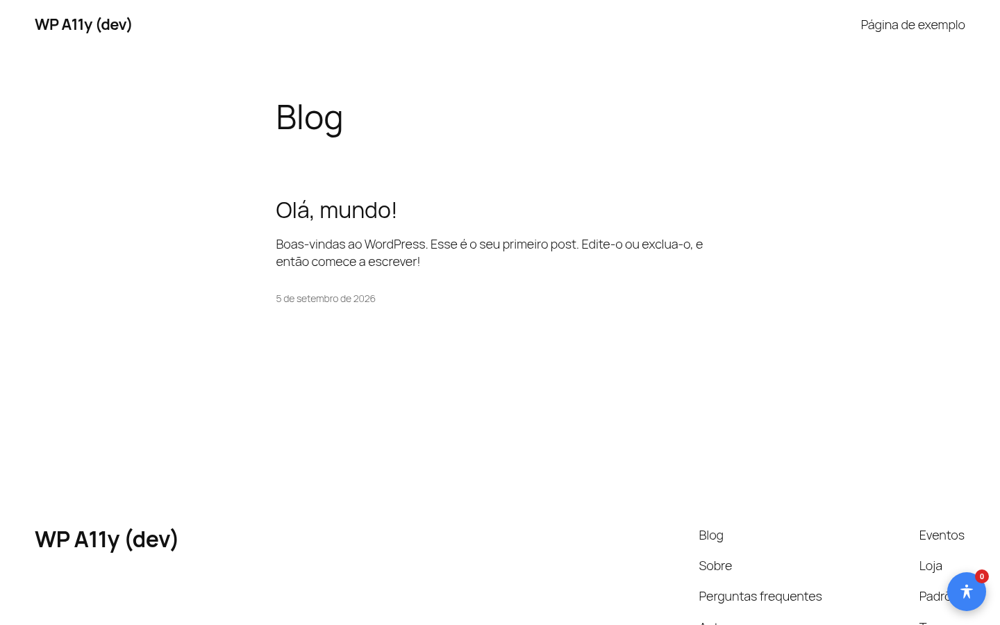
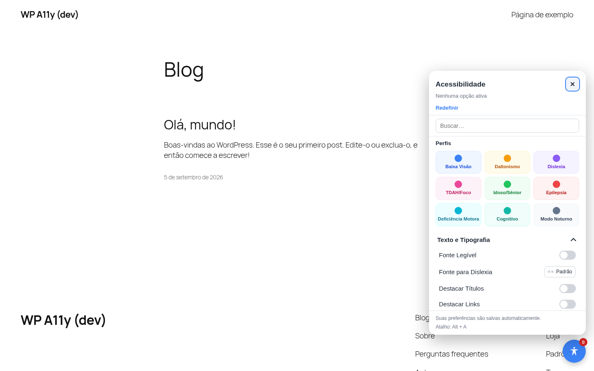
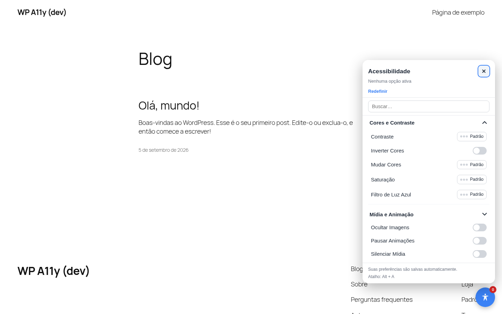
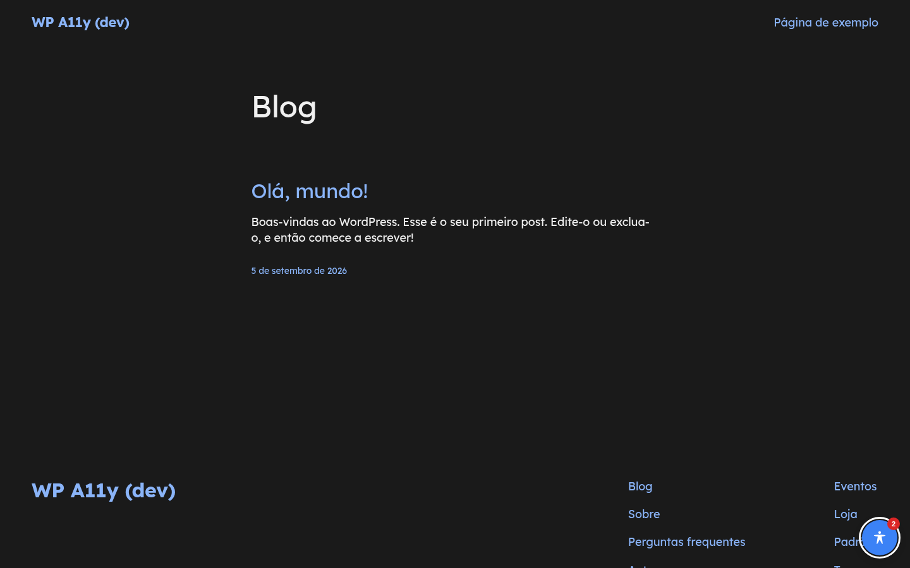

# wp-a11y

Plugin de acessibilidade para WordPress — port do plugin [`local_a11y`](https://github.com/padilhars/a11y), desenvolvido originalmente para Moodle.

## Status

**Fases 0-5 concluídas — v1.0.4.**

Fase 0 (esqueleto de dados):

- 29 opções de acessibilidade (`WP_A11y\Options`) e 9 perfis prontos (`WP_A11y\Profiles`), transcritos do `local_a11y` atual (não do protótipo `_design-reference/`, que está desatualizado — ver DECISIONS.md D1).
- Configurações do admin em `/wp-admin/admin.php?page=wp-a11y` (5 seções: Geral, FAB, Painel, Cores, Estatísticas), armazenadas em uma única opção `wp_a11y_settings`.
- Tabela de estatísticas agregadas e anônimas (`{prefix}wp_a11y_stats`) + relatório em `/wp-admin/admin.php?page=wp-a11y-stats`.

Fase 1 (FAB + painel + efeitos CSS puros):

- Botão flutuante + painel (popover/gaveta/modal conforme configuração; sempre gaveta em telas pequenas), com busca, perfis, categorias colapsáveis, atalho `Alt+A`, `Esc` fecha, focus trap.
- 19 das 29 opções têm efeito visual real via classes `body.a11y-*` (`assets/css/a11y-effects.css`): tipografia (incl. 3 fontes OFL auto-hospedadas — Atkinson Hyperlegible, Lexend, OpenDyslexic), cores/contraste (incl. simulação de daltonismo via filtros SVG `feColorMatrix`), mídia (ocultar imagens/pausar animações) e foco/navegação (cursor, modo foco). As 10 restantes são módulos JS sob demanda, completados na Fase 3 abaixo.
- Persistência via `localStorage` para visitantes; usuários logados agora sincronizam de verdade com o servidor (Fase 2, abaixo). Script no-FOUC (`wp_body_open`) aplica o estado salvo antes da 1ª pintura.
- Testado com Chrome headless real: FAB/painel renderizam e funcionam, toggles/perfis/persistência/reload confirmados sem erros de console.

Fase 2 (REST API + estatísticas):

- `GET`/`POST /wp-json/wp-a11y/v1/settings` (autenticado, nonce `wp_rest`): usuário logado lê/escreve sua preferência real em `usermeta`, sincronizada entre dispositivos. Migração automática de qualquer preferência de visitante salva em `localStorage` no primeiro login sem preferência salva ainda.
- Script no-FOUC agora embute a preferência **real** do usuário logado (lida direto do `usermeta` no PHP) em vez de sempre depender do `localStorage` — elimina o flash de FOUC que a Fase 1 ainda tinha para quem já estava logado.
- `POST /wp-json/wp-a11y/v1/activate`: contador de ativação por opção, mesma validação/allowlist server-side de antes (Fase 0), agora de fato alimentado pelo painel — disparado (fire-and-forget) sempre que uma opção passa de padrão→ativa, só quando a coleta de estatísticas está ligada.
- Relatório de estatísticas (`/wp-admin/admin.php?page=wp-a11y-stats`) agora mostra dados reais.
- Testado ponta a ponta com Chrome headless real (login incluso): sincronização de preferência, reidratação sem FOUC após reload, e contador de estatísticas confirmados direto no banco.

Fase 3 (módulos avançados, um de cada vez — concluída, 10/10):

- **Dicas de Ferramentas** (`tooltips`): converte `[title]` nativo (pequeno, com atraso, só no mouse) numa dica visível também por foco de teclado (`assets/js/features/tooltips.js`).
- **Silenciar Mídia** (`silenceMedia`): muta todo `<audio>`/`<video>` da página, incluindo mídia que começa a tocar depois de ativado; restaura o estado original ao desativar (`silence-media.js`).
- **Leitura Biônica** (`bionicReading`): negrita a primeira metade de cada palavra do conteúdo real da página, reversível sem perder o texto original (`bionic-reading.js`).
- **Guia de Leitura** (`readingGuide`): faixa horizontal destacada (cor configurável em Cores) que acompanha o mouse verticalmente, ajudando a manter a linha de leitura (`reading-guide.js`).
- **Máscara de Leitura** (`readingMask`): duas faixas escurecidas acima/abaixo do cursor, isolando uma janela de leitura de ~120px (`reading-mask.js`).
- **Lupa** (`magnifier`): lente circular que segue o mouse mostrando uma cópia ampliada (2,2×) do conteúdo sob o cursor — clona `#wp-a11y-content-wrap` uma vez e só reposiciona via `transform` a cada movimento (`magnifier.js`).
- **Leitor de Tela** (`screenReader`): passar o mouse destaca qualquer texto da página (títulos, parágrafos, links, botões, etc.); clicar lê em voz alta via `speechSynthesis` nativo do navegador — nenhum áudio é enviado a lugar nenhum, é 100% processamento local do navegador (`screen-reader.js`).
- **Teclado Virtual** (`virtualKeyboard`): aparece automaticamente ao focar um campo de texto dentro do conteúdo da página; digita usando `execCommand('insertText'/'delete')`, que preserva posição do cursor e dispara os eventos `input` reais (`virtual-keyboard.js`).
- **Comandos por Voz** (`voiceCommands`): controla o painel e ~35 comandos falados (tipografia, cores, navegação, rolagem) via `SpeechRecognition` nativo do navegador — o áudio é enviado a um serviço remoto do próprio navegador (não deste site), por isso exige aviso de privacidade e consentimento explícito antes de começar, com uma pílula de status/feedback na tela (`voice-commands.js`).
- **Navegação por Face** (`faceNavigation`): move um cursor virtual com movimentos da cabeça e "clica" abrindo a boca ou piscando, via MediaPipe FaceLandmarker rodando 100% no navegador — a imagem da câmera nunca é enviada a lugar nenhum. Os dois arquivos de terceiros necessários (bundle de visão + modelo) são baixados ao vivo e verificados por SHA-256 antes do uso, fechando o mesmo gap TOCTOU que o `local_a11y` trata; exige aviso de privacidade/consentimento antes de pedir acesso à câmera (`face-navigation.js`).
- Cada módulo é importado dinamicamente (`import()` por URL, sem bundler) só na primeira ativação real da opção — nada é baixado à toa. Todos testados ligando/desligando de verdade num Chrome headless (efeito aplicado E revertido corretamente, posições/transformações conferidas, digitação de verdade num campo de teste, sem erro de console) — Comandos por Voz e Navegação por Face testados com `SpeechRecognition`/câmera e MediaPipe simulados (mock), já que o ambiente de CI/headless não tem microfone/câmera reais nem pode validar o hash de um modelo de verdade sem rede liberada para o CDN. Ver DECISIONS.md D10 sobre um falso alarme de bug encontrado (e descartado) durante esse teste.

Fase 4 (privacidade + auditoria de segurança/qualidade):

- **Privacy API** (`includes/class-privacy.php`): exporter e eraser da única preferência pessoal que o plugin guarda (`wp_a11y_settings`, usermeta), registrados em Ferramentas > Exportar/Apagar Dados Pessoais; texto sugerido de política de privacidade (`wp_add_privacy_policy_content()`) cobrindo a preferência em si e os dois recursos cujo *navegador* conversa com um terceiro quando ativados (Comandos por Voz → serviço de reconhecimento de fala do fabricante do navegador; Navegação por Face → dois arquivos baixados ao vivo do MediaPipe, imagem da câmera nunca sai do navegador). A tabela de estatísticas agregadas não é declarada — não tem coluna que identifique ninguém. Testado com um usuário real via `wp eval`: exportação/exclusão confirmadas ponta a ponta. Ver DECISIONS.md D11.
- **Auditoria PHPCS** (`WordPress-Extra`): 3 erros reais encontrados e corrigidos em `class-stats.php` (nome de tabela interpolado direto na query em vez do placeholder `%i` do `$wpdb->prepare()` — não era injeção de verdade na prática, mas corrigido mesmo assim; um comentário de supressão existente também apontava para o código de sniff errado). Verificado com uma ativação de teste de verdade no banco. Os outros 57 achados eram só formatação (corrigida automaticamente com `phpcbf`, comportamento reconfirmado depois).
- **Auditoria ESLint**: zero erros reais em `assets/js/**`; 18 avisos cosméticos limpos (blocos `catch` com a exceção nunca usada convertidos para `catch {}`, um `let` trocado por `const`). Comportamento reconfirmado com os mesmos testes mock de Comandos por Voz/Navegação por Face.
- **XSS do JSON inline** (`class-render.php`): já seguro por construção — os únicos dados de usuário embutidos em `<script>` (a preferência do usuário logado, no script anti-FOUC) já passam por `Manager::sanitize_settings()`, que só produz booleanos e inteiros limitados por opção, nunca uma string livre; não havia nada para um atacante injetar independentemente da forma de escaping usada.
- Ver DECISIONS.md D12 para o relato completo da auditoria.

Fase 5 (polimento/documentação):

- `CHANGELOG.md` (novo) - histórico de todas as fases, formato [Keep a Changelog](https://keepachangelog.com/).
- `languages/wp-a11y.pot` (novo) - template de tradução gerado via `wp i18n make-pot`, 101 strings.
- Capturas de tela reais (`docs/screenshots/`, ver abaixo) - painel, perfis, categorias e um efeito realmente aplicado (não só mockup).
- Versão promovida de `0.1.0` para `1.0.0` - mesmo critério do `local_a11y` (D65 lá): cortar uma versão de verdade num marco significativo (Fases 0-5 completas) em vez de deixar acumulando como "não lançado" indefinidamente.
- Empacotamento: `bin/build-zip.sh` (novo) gera `wp-a11y.zip` pronto para instalar via wp-admin, excluindo arquivos só de desenvolvimento (`.git`, `DECISIONS.md`, `docs/`, `bin/`).

**v1.0.1** — paridade visual com o painel do `local_a11y` (Moodle): ícones/descrições/botões de ajuda das opções (já existiam nos dados desde a Fase 0, mas nunca chegavam ao HTML - `includes/class-icons.php` novo), cabeçalho/categorias/perfis com o mesmo tratamento visual (selo, versalete, ícone), fonte `Inter` auto-hospedada. Ver DECISIONS.md D14.

**v1.0.2** — categorias agora colapsam de verdade (bug de CSS: `display` incondicional empatando com `[hidden]`) e opções ativam clicando em qualquer parte da linha, não só no switch/stepper. Ver DECISIONS.md D15.

**v1.0.3** — steppers agora mostram o nome do nível ativo (ex.: "Lexend", "Alto Contraste") em vez de uma fração genérica ("1/2"). Ver DECISIONS.md D16.

**v1.0.4** — rodapé do painel reestruturado para ficar idêntico ao do `local_a11y` (layout texto+badge "Alt+A" na mesma linha, mesmo texto padrão). Ver DECISIONS.md D17.

**Nunca misturar este repositório com o `local_a11y`/Moodle** — o código Moodle é usado só como referência de leitura. Fontes de terceiros (OFL) foram baixadas de novo das fontes originais, não copiadas de lá — ver `assets/fonts/THIRDPARTY.md`.

## Capturas de tela

| | |
|---|---|
|  Botão flutuante |  Painel: perfis + categoria de tipografia |
|  Painel: cores/contraste + mídia |  Alto contraste + fonte para dislexia aplicados de verdade |

## Ambiente de desenvolvimento

- WordPress instalado em `/var/www/wp-a11y/html`
- Banco de dados: MariaDB (`wp_a11y`)
- Este diretório é o repositório do plugin, montado diretamente em `wp-content/plugins/wp-a11y`
- URL: https://wp.snifrbid.com.br

## Licença

GPL v3 ou posterior — ver [LICENSE](LICENSE).
